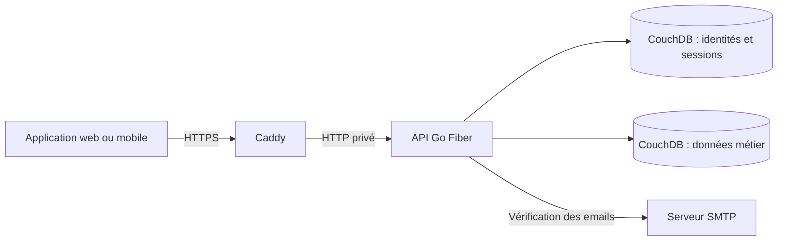

# StageOps Backend

[](https://github.com/StageOps-EIP/StageOps-backend/actions/workflows/backend.yml)

**L’API de StageOps pour organiser les opérations techniques d’un théâtre.**

Ce service centralise les projets scéniques, le matériel, les incidents, les événements et les équipes. Il gère également les comptes utilisateurs, les droits d’accès et les sessions des applications clientes web et mobile.

Le backend est développé en **Go avec Fiber** et utilise **CouchDB** pour la persistance. Les données sont rattachées à un théâtre et les opérations sensibles sont contrôlées côté serveur.

## Sommaire

- [Fonctionnalités](#fonctionnalités)
- [Stack et architecture](#stack-et-architecture)
- [Démarrage local](#démarrage-local)
- [Premiers appels API](#premiers-appels-api)
- [Rôles, modules et isolation des données](#rôles-modules-et-isolation-des-données)
- [Référence des routes](#référence-des-routes)
- [Authentification et fonctionnement hors ligne](#authentification-et-fonctionnement-hors-ligne)
- [Configuration](#configuration)
- [Tests et intégration continue](#tests-et-intégration-continue)
- [Déploiement et exploitation](#déploiement-et-exploitation)
- [Dépannage](#dépannage)
- [Documentation et contribution](#documentation-et-contribution)
- [Statut du projet](#statut-du-projet)

## Fonctionnalités

| Domaine | Fonctionnalités disponibles |
| --- | --- |
| Comptes et sessions | Inscription, vérification d’email, connexion, renouvellement des tokens, déconnexion et révocation des sessions. |
| Autorisations | Rôles techniques, attribution de plusieurs modules et contrôle des opérations selon la configuration du projet. |
| Projets | Création, consultation, modification et suppression ; lieu, dates et activation des modules lumière, son et plateau. |
| Matériel | Inventaire par projet et module, état du matériel, positions 3D, adressage DMX et détection des chevauchements de canaux. |
| Incidents | Suivi par projet pour la lumière et le son, gravité, statut, matériel associé et informations de résolution. |
| Événements et équipes | Gestion des événements opérationnels et des fiches des membres d’équipe. |
| Isolation par théâtre | Utilisateurs, sessions et données métier rattachés à un `theatre_id` ; requêtes et cache des modules séparés par théâtre. |
| Appareils et hors ligne | Enregistrement et révocation des appareils, autorisations locales signées Ed25519 et publication des clés publiques. |
| Audit et exploitation | Journalisation des opérations sensibles, contrôles de santé, sauvegarde, restauration et migration des données historiques. |

**Périmètre du hors ligne :** l’API fournit les autorisations vérifiables localement. La passerelle de réplication distante entre PouchDB et CouchDB reste à implémenter. Voir [Authentification et fonctionnement hors ligne](#authentification-et-fonctionnement-hors-ligne).

## Stack et architecture

| Élément | Choix du dépôt |
| --- | --- |
| Langage | Go 1.27 ; image de compilation Docker épinglée sur Go 1.27.2. |
| Serveur HTTP | Fiber v2. |
| Base de données | CouchDB, interrogé via son API HTTP ; image de base `couchdb:3.5.2.1`. |
| Authentification | JWT HS256, mots de passe hachés avec bcrypt et refresh tokens persistants. |
| Autorisations hors ligne | Signatures Ed25519 et clés publiques au format JWKS. |
| Vérification des emails | SMTP avec STARTTLS ou TLS implicite. |
| Production | Docker Compose, reverse proxy Caddy et HTTPS avec TLS 1.3. |
| Qualité | Tests Go, détecteur de courses, `go vet`, `govulncheck` et GitHub Actions. |

En production, les requêtes suivent ce parcours :



Les deux bases CouchDB résident sur la même instance serveur, dans un volume persistant. CouchDB reste sur un réseau Docker privé en production.

```text
cmd/server/          Configuration, démarrage, routes HTTP et contrôles de santé
internal/
  auth/              Comptes, JWT, sessions, emails, appareils et autorisations
  projects/          Projets scéniques et configuration de leurs modules
  equipment/         Inventaire, positions 3D et contraintes DMX
  incidents/         Déclaration et suivi des incidents
  events/            Événements opérationnels
  team/              Fiches des membres d’équipe
  modules/           Configuration et cache des modules par théâtre
  tenant/            Propagation du théâtre dans le contexte des requêtes
  audit/             Persistance des événements d’audit
  couch/             Client HTTP CouchDB partagé
Dockerfile           Construction de l’image du backend
entrypoint.sh        Initialisation de CouchDB et lancement du serveur
docker-compose.prod.yml  Services et réseaux de production
deploy/              Déploiement, sauvegarde, restauration et migration
docs/                Guides et décisions d’architecture
.github/             Workflow CI et configuration d’intégration
```

Les domaines métier suivent le découpage **handler → service → repository** : le handler traite la requête HTTP, le service applique les règles métier et le repository accède à CouchDB.

## Démarrage local

### Prérequis

- Git et Docker avec le plugin `docker compose`.
- Un terminal Bash ou compatible, par exemple sous Linux, macOS ou WSL.
- OpenSSL pour générer les secrets et `curl` pour essayer l’API.
- Pour développer hors du conteneur : Go 1.27 ou compatible avec la directive de [go.mod](go.mod).

Les commandes suivantes s’exécutent à la racine du dépôt. La configuration locale utilise le port **3000** pour l’API et **5984** pour CouchDB, tous deux accessibles uniquement depuis la machine hôte.

### 1. Récupérer le projet et préparer la configuration

```bash
git clone https://github.com/StageOps-EIP/StageOps-backend.git
cd StageOps-backend
cp .env.example .env
```

Dans `.env`, remplacer les valeurs de `COUCHDB_PASSWORD`, `JWT_SECRET`, `USER_ID_SECRET` et `OFFLINE_SIGNING_KEY`. Utiliser une valeur distincte pour chaque secret :

```bash
# Exécuter séparément pour le mot de passe CouchDB et chacun des deux secrets.
openssl rand -base64 48

# Graine Ed25519 de 32 octets pour OFFLINE_SIGNING_KEY.
openssl rand -base64 32
```

Pour ce démarrage local, conserver `APP_PORT=3000`, `ALLOW_PUBLIC_REGISTRATION=true` et `AUTH_REQUIRE_EMAIL_VERIFICATION=false`. Cette dernière option permet de démarrer sans serveur SMTP.

### 2. Configurer le premier régisseur général

Ajouter ces deux variables à `.env`, en remplaçant le mot de passe d’exemple :

```dotenv
BOOTSTRAP_ADMIN_EMAIL=admin@example.com
BOOTSTRAP_ADMIN_PASSWORD=Change-This-Dev-Password-42!
```

Le mot de passe doit contenir **12 à 72 octets**, dont une minuscule, une majuscule, un chiffre et un caractère spécial. Au démarrage, le serveur crée ce compte uniquement lorsqu’aucun compte `rg` n’existe déjà. Une inscription publique crée un compte `plateau` ; elle ne crée pas d’administrateur.

### 3. Créer la configuration Docker locale

Créer le fichier suivant. `docker-compose.dev.yml` est volontairement ignoré par Git pour permettre une configuration propre à chaque poste.

```bash
cat > docker-compose.dev.yml <<'YAML'
name: stageops-dev

services:
  couchdb:
    image: couchdb:3.5.2.1
    environment:
      COUCHDB_USER: ${COUCHDB_USER:?COUCHDB_USER is required}
      COUCHDB_PASSWORD: ${COUCHDB_PASSWORD:?COUCHDB_PASSWORD is required}
    ports:
      - "127.0.0.1:5984:5984"
    volumes:
      - couchdb_dev_data:/opt/couchdb/data
      - ./deploy/couchdb/stageops.ini:/opt/couchdb/etc/local.d/stageops.ini:ro

  backend:
    build: .
    env_file: .env
    environment:
      COUCHDB_URL: http://couchdb:5984
    ports:
      - "127.0.0.1:3000:3000"
    depends_on:
      - couchdb

volumes:
  couchdb_dev_data:
YAML

docker compose --env-file .env -f docker-compose.dev.yml up --build -d --wait
```

L’entrypoint du backend attend CouchDB, crée les bases nécessaires, applique les vues et initialise les modules du théâtre. Le premier build télécharge les images et les dépendances Go. L’option `--wait` attend que le backend passe son contrôle de santé.

### 4. Vérifier le démarrage

```bash
docker compose -f docker-compose.dev.yml ps
docker compose -f docker-compose.dev.yml logs --tail=100 backend
curl --fail http://localhost:3000/api/health/ready
```

Lorsque l’API et CouchDB sont prêts, le dernier appel renvoie :

```json
{"status":"ok"}
```

La console d’administration CouchDB est accessible en local à l’adresse `http://localhost:5984/_utils/`, avec les identifiants `COUCHDB_USER` et `COUCHDB_PASSWORD`.

Pour arrêter les services en conservant les données :

```bash
docker compose -f docker-compose.dev.yml down
```

### Développer avec Go sur la machine hôte

Après un premier démarrage Docker réussi, il est possible de conserver CouchDB et d’exécuter l’API directement avec Go :

```bash
docker compose -f docker-compose.dev.yml stop backend

# Charger les variables : le serveur Go ne lit pas .env automatiquement.
set -a
. ./.env
set +a

go mod download
go run ./cmd/server
```

Dans ce mode, `COUCHDB_URL` doit pointer vers `http://localhost:5984`, comme dans `.env.example`. Les bases et les vues sont celles initialisées précédemment : **`go run` seul ne les crée pas**. Après une modification de `.env`, recharger les variables avant de relancer le processus.

## Premiers appels API

Les exemples supposent une API locale sur le port 3000 et le compte RG configuré ci-dessus. Adapter le mot de passe à celui choisi dans `.env`.

### Se connecter

```bash
API_URL=http://localhost:3000

curl --fail-with-body --silent --show-error \
  --request POST "$API_URL/api/auth/login" \
  --header 'Content-Type: application/json' \
  --data '{"email":"admin@example.com","password":"Change-This-Dev-Password-42!"}'
```

La réponse contient un `access_token`, un `refresh_token`, le type `Bearer` et la durée de validité de l’access token en secondes (`expires_in`). Copier l’access token pour les appels suivants :

```bash
ACCESS_TOKEN='<valeur du champ access_token>'

curl --fail-with-body --silent --show-error \
  "$API_URL/api/auth/me" \
  --header "Authorization: Bearer $ACCESS_TOKEN"
```

### Créer un projet

```bash
curl --fail-with-body --silent --show-error \
  --request POST "$API_URL/api/projects/" \
  --header "Authorization: Bearer $ACCESS_TOKEN" \
  --header 'Content-Type: application/json' \
  --data '{
    "name": "Festival StageOps",
    "venue": "Grande salle",
    "start_date": "2026-11-02",
    "end_date": "2026-11-08",
    "modules_config": {"lighting": true, "audio": true, "stage": true}
  }'
```

Les dates des projets utilisent le format `YYYY-MM-DD`. Copier le champ `id` de la réponse pour retrouver le projet ou lui rattacher du matériel :

```bash
PROJECT_ID='<valeur du champ id>'

curl --fail-with-body --silent --show-error \
  "$API_URL/api/projects/$PROJECT_ID" \
  --header "Authorization: Bearer $ACCESS_TOKEN"
```

### Ajouter un équipement lumière

```bash
curl --fail-with-body --silent --show-error \
  --request POST "$API_URL/api/projects/$PROJECT_ID/equipment/lighting/" \
  --header "Authorization: Bearer $ACCESS_TOKEN" \
  --header 'Content-Type: application/json' \
  --data '{
    "name": "Lyre face jardin",
    "kind": "moving-head",
    "dmx_universe": 1,
    "dmx_address": 100,
    "dmx_channels": 16,
    "position": {"x": 2.5, "y": 4, "z": 1}
  }'
```

Cet équipement occupe les adresses **100 à 115** de l’univers 1. Une plage chevauchante dans le même projet et module est refusée avec `409 DMX_CONFLICT`. Une plage doit rester comprise entre 1 et 512 ; l’adressage DMX est réservé au module `lighting`.

### Déclarer un incident

```bash
curl --fail-with-body --silent --show-error \
  --request POST "$API_URL/api/projects/$PROJECT_ID/incidents/lighting/" \
  --header "Authorization: Bearer $ACCESS_TOKEN" \
  --header 'Content-Type: application/json' \
  --data '{
    "title": "Projecteur sans réponse",
    "description": "La lyre ne répond plus aux commandes DMX.",
    "severity": "high",
    "status": "open"
  }'
```

Pour les incidents, les gravités sont `low`, `medium`, `high`, `critical` et les statuts sont `open`, `in-progress`, `resolved`, `closed`.

## Rôles, modules et isolation des données

### Correspondance des noms

| Domaine | Rôle ou module attribué à un utilisateur | Clé dans les projets et routes métier |
| --- | --- | --- |
| Régie générale | `rg` | Administration des projets et des comptes du théâtre. |
| Lumière | `lumiere` | `lighting` |
| Son | `son` | `audio` |
| Plateau | `plateau` | `stage` |

Un utilisateur possède un rôle et peut recevoir plusieurs modules dans `assigned_modules`. Par exemple, `{"assigned_modules":["lumiere","son"]}` permet de lui attribuer les deux domaines. Le RG peut modifier le rôle et les modules via les routes `/api/users/:id/role` et `/api/users/:id/modules`.

### Règles principales

- Le RG gère les projets, les rôles, les attributions et la configuration des modules de son théâtre.
- Pour accéder au matériel ou aux incidents d’un module, un technicien doit avoir ce module attribué. Le RG peut accéder à tous les modules.
- Les créations, modifications et suppressions de matériel ou d’incidents nécessitent aussi que le module soit actif **dans le projet**, y compris pour le RG. La lecture reste possible pour un utilisateur autorisé lorsque ce module est désactivé.
- Le matériel prend en charge `lighting`, `audio` et `stage`. Les incidents prennent en charge `lighting` et `audio`.
- Le théâtre de la requête provient de l’identité authentifiée. Un client ne choisit pas son théâtre en ajoutant un `theatre_id` dans un payload métier.

Les routes `/api/modules/` configurent l’état des modules au niveau du théâtre. La configuration `modules_config` appartient à chaque projet ; les routes matériel et incidents vérifient cette configuration de projet.

Les fiches gérées par `/api/team/` décrivent les membres d’équipe. La création d’une fiche ne crée pas de compte d’authentification.

## Référence des routes

Les requêtes avec un corps utilisent `Content-Type: application/json`. Les routes protégées attendent `Authorization: Bearer <access_token>`.

Dans les tableaux, **authentifié** signifie « session valide et données du même théâtre » ; **RG** désigne le rôle `rg`. Le préfixe `/api` s’applique à toutes les routes ci-dessous, sauf `/.well-known/jwks.json`.

### Authentification et appareils

| Méthode | Route | Accès / usage |
| --- | --- | --- |
| `POST` | `/api/auth/register` | Public si l’inscription est activée ; email et mot de passe. |
| `POST` | `/api/auth/verify-email` | Public ; token de vérification dans le champ `token`. |
| `POST` | `/api/auth/resend-verification` | Public ; demande de renvoi pour un `email`. |
| `POST` | `/api/auth/login` | Public ; renvoie une paire access/refresh. |
| `POST` | `/api/auth/refresh` | Refresh token dans le corps ; renouvelle les tokens. |
| `POST` | `/api/auth/logout` | Refresh token dans le corps ; révoque sa session. |
| `POST` | `/api/auth/logout-all` | Authentifié ; révoque toutes les sessions du compte. |
| `GET` | `/api/auth/me` | Authentifié ; profil courant. |
| `GET` | `/api/auth/devices` | Authentifié ; appareils du compte. |
| `POST` | `/api/auth/offline-grants` | Authentifié ; nom d’appareil dans `name`, renvoie une autorisation signée. |
| `DELETE` | `/api/auth/devices/:id` | Authentifié ; révoque un appareil du compte. |
| `GET` | `/.well-known/jwks.json` | Public ; clés publiques de vérification Ed25519. |

Pour `refresh` et `logout`, le corps est `{"refresh_token":"<valeur>"}`. Les routes d’authentification appliquent une validation JSON stricte et une limite de 16 Kio par corps de requête.

### Administration et projets

| Méthode | Route | Accès / usage |
| --- | --- | --- |
| `PATCH` | `/api/users/:id/role` | RG ; `{"role":"son"}` par exemple. |
| `PATCH` | `/api/users/:id/modules` | RG ; tableau `assigned_modules`. |
| `GET` | `/api/modules/` | RG ; modules du théâtre. |
| `PATCH` | `/api/modules/:name/toggle` | RG ; inverse l’état de `lumiere`, `son` ou `plateau`. |
| `GET` | `/api/projects/` | Authentifié ; liste des projets. |
| `POST` | `/api/projects/` | RG ; création d’un projet. |
| `GET` | `/api/projects/:id` | Authentifié ; détail d’un projet. |
| `PATCH`, `DELETE` | `/api/projects/:id` | RG ; modification ou suppression. |

### Matériel et incidents

| Méthode | Route | Accès / usage |
| --- | --- | --- |
| `GET`, `POST` | `/api/projects/:projectId/equipment/:module/` | Liste ou création de matériel dans un module autorisé. |
| `GET`, `PATCH`, `DELETE` | `/api/projects/:projectId/equipment/:module/:id` | Lecture, modification ou suppression d’un équipement. |
| `GET`, `POST` | `/api/projects/:projectId/incidents/:module/` | Liste ou déclaration d’incidents dans un module autorisé. |
| `GET`, `PATCH`, `DELETE` | `/api/projects/:projectId/incidents/:module/:id` | Lecture, modification ou suppression d’un incident. |

Les règles de module actif et d’attribution décrites plus haut s’appliquent à ces routes.

### Événements, équipes et santé

| Méthode | Route | Accès / usage |
| --- | --- | --- |
| `GET`, `POST` | `/api/events/` | Authentifié ; liste ou création d’un événement. |
| `GET`, `PATCH` | `/api/events/:id` | Authentifié ; lecture ou modification. |
| `DELETE` | `/api/events/:id` | RG ; suppression. |
| `GET` | `/api/team/` | Authentifié ; liste des membres d’équipe. |
| `POST` | `/api/team/` | RG ; création d’une fiche. |
| `GET` | `/api/team/:id` | Authentifié ; détail d’un membre. |
| `PATCH`, `DELETE` | `/api/team/:id` | RG ; modification ou suppression. |
| `GET` | `/api/health/live` | Public ; processus HTTP disponible. |
| `GET` | `/api/health/ready` | Public ; processus HTTP et CouchDB disponibles. |
| `GET` | `/api/health` | Alias public de `ready`. |

### Réponses et erreurs

Les lectures et mises à jour réussies renvoient généralement `200`, les créations `201` et les suppressions `204` sans corps. Les erreurs utilisent cette enveloppe, éventuellement enrichie d’un objet `fields` pour la validation des champs :

```json
{
  "error": {
    "code": "DMX_CONFLICT",
    "message": "Cette plage DMX chevauche un équipement existant."
  }
}
```

| Statut HTTP | Interprétation habituelle |
| --- | --- |
| `400` | Corps invalide ou règle de validation non respectée. |
| `401` | Authentification absente, token invalide, session expirée ou révoquée. |
| `403` | Droits insuffisants, module inactif ou email non vérifié. |
| `404` | Ressource introuvable ou masquée parce qu’elle appartient à un autre théâtre. |
| `409` | Email ou nom déjà utilisé, conflit de révision CouchDB ou chevauchement DMX. |
| `429` | Limite de requêtes atteinte ou compte temporairement verrouillé. |
| `500` | Erreur interne lors du traitement. |
| `503` | Vérification des sessions/autorisations indisponible, ou CouchDB indisponible sur la route de disponibilité. |

## Authentification et fonctionnement hors ligne

### Cycle d’une session

1. L’inscription crée un utilisateur dans le théâtre `DEFAULT_THEATRE_ID`.
2. Lorsque la vérification d’email est activée, l’API demande cette vérification avant de permettre la connexion. Un lien à usage unique est envoyé par SMTP ; la validation du token crée une première session.
3. La connexion renvoie un **access token de 15 minutes** et un **refresh token de 30 jours**.
4. `/api/auth/refresh` remplace le refresh token par un nouveau. La réutilisation d’un ancien refresh token révoque la famille de session concernée.
5. `/api/auth/logout` révoque une session ; `/api/auth/logout-all` révoque toutes les sessions de l’utilisateur.

Le middleware relit la session et l’utilisateur dans CouchDB. Une révocation ou un changement de droits prend donc effet sur les requêtes protégées suivantes. Les mots de passe sont hachés avec bcrypt ; les refresh tokens et tokens de vérification sont stockés sous forme de hash.

L’application cliente doit conserver ses refresh tokens dans le stockage sécurisé de sa plateforme et ses access tokens en mémoire. Le guide [Authentification](docs/authentication.md) détaille les flux, le stockage et les propriétés de sécurité.

### Autorisations locales

`POST /api/auth/offline-grants` délivre une autorisation Ed25519 liée à un utilisateur, un théâtre, un appareil et ses modules, valable au maximum sept jours. Le client peut la vérifier sans contacter l’API grâce aux clés de `/.well-known/jwks.json`.

Cette autorisation permet au client de contrôler l’accès à sa base locale. Elle n’est pas acceptée comme access token par l’API et ne donne pas un accès administrateur à CouchDB. Un appareil déconnecté conserve son autorisation déjà téléchargée jusqu’à son expiration ; une révocation ne peut lui être transmise qu’à la reconnexion.

**La réplication distante PouchDB ↔ CouchDB n’est pas encore disponible.** Elle nécessite un accès client dédié, filtré par théâtre/projet et excluant les données d’identité, sessions et audits d’authentification.

## Configuration

[.env.example](.env.example) fournit les valeurs de développement ; [.env.production.example](.env.production.example) décrit la configuration de production. Les valeurs par défaut ci-dessous sont celles du serveur, sauf indication contraire.

### Base de données et identité

| Variable | Valeur par défaut / contrainte | Usage |
| --- | --- | --- |
| `COUCHDB_URL` | Requise | URL de CouchDB ; `http://localhost:5984` depuis la machine hôte, `http://couchdb:5984` dans Compose. |
| `COUCHDB_DB` | Requise | Base des données métier. |
| `COUCHDB_AUTH_DB` | `stageops_auth` | Base des utilisateurs, sessions, appareils et audits d’authentification. |
| `COUCHDB_USER`, `COUCHDB_PASSWORD` | Requis | Identifiants CouchDB utilisés par le backend. |
| `JWT_SECRET` | Requis, au moins 32 caractères | Signature des access tokens HS256. |
| `USER_ID_SECRET` | Requis, au moins 32 caractères | Secret HMAC distinct pour les identifiants utilisateurs. |
| `JWT_ISSUER` | `stageops-api` | Émetteur attendu des JWT. |
| `JWT_AUDIENCE` | `stageops-clients` | Audience attendue des access tokens. |
| `DEFAULT_THEATRE_ID` | Requis | Théâtre de l’inscription publique, du bootstrap et des données historiques migrées. |
| `BOOTSTRAP_ADMIN_EMAIL`, `BOOTSTRAP_ADMIN_PASSWORD` | Facultatifs, à fournir ensemble | Création initiale du premier RG. Retirer ces valeurs après l’initialisation de production. |

Conserver `USER_ID_SECRET` stable pour une base existante : il intervient dans la construction des identifiants. Le changement des secrets et du théâtre d’une instance existante doit être préparé comme une opération de migration.

### Inscription, emails et appareils

| Variable | Valeur par défaut / contrainte | Usage |
| --- | --- | --- |
| `ALLOW_PUBLIC_REGISTRATION` | `true` dans le serveur ; `false` dans Compose de production | Active l’inscription publique dans le théâtre par défaut. |
| `AUTH_REQUIRE_EMAIL_VERIFICATION` | `true` ; `false` dans l’exemple local | Exige la vérification de l’email. |
| `SMTP_HOST`, `SMTP_PORT`, `SMTP_FROM` | Requis lorsque la vérification est activée | Serveur, port et expéditeur ; port `587` dans les exemples. |
| `SMTP_USERNAME`, `SMTP_PASSWORD` | Facultatifs | Identifiants SMTP. |
| `SMTP_IMPLICIT_TLS` | `false` | Utilise STARTTLS par défaut ; `true` sélectionne TLS dès la connexion. |
| `AUTH_VERIFICATION_URL` | Requise lorsque la vérification est activée | URL cliente utilisée pour construire le lien de confirmation. |
| `OFFLINE_SIGNING_KEY` | Requise | Graine Ed25519 de 32 octets encodée en base64. |
| `OFFLINE_KEY_ID` | `offline-2026-01` | Identifiant public de la clé de signature. |
| `OFFLINE_AUDIENCE` | `stageops-offline` | Audience des autorisations locales. |

### Serveur HTTP et conteneurs

| Variable | Valeur par défaut / contrainte | Usage |
| --- | --- | --- |
| `APP_PORT` | `3000` | Port HTTP ; le Compose de production fixe cette valeur à `3000`. |
| `CORS_ORIGINS` | `http://localhost:8080` dans le serveur | Origines clientes autorisées, séparées par des virgules. |
| `TLS_CERT`, `TLS_KEY` | Facultatifs, à fournir ensemble | TLS directement dans Fiber ; en production, Caddy termine HTTPS. |
| `COUCHDB_STARTUP_ATTEMPTS` | `60` | Nombre d’essais de l’entrypoint, espacés de deux secondes, pour attendre CouchDB. |
| `API_DOMAIN` | Requis par le Compose de production | Domaine public de l’API pour Caddy. |
| `BACKEND_CPUS`, `BACKEND_MEMORY` | `1.0`, `512m` | Limites du conteneur backend en production. |
| `COUCHDB_CPUS`, `COUCHDB_MEMORY` | `1.0`, `1g` | Limites du conteneur CouchDB en production. |

## Tests et intégration continue

### Vérifications locales

Avec Go installé :

```bash
go test ./...
go vet ./...
go test -race ./...
```

Les tests unitaires utilisent des doubles de test ou des serveurs HTTP locaux et ne nécessitent pas d’instance CouchDB. Le détecteur de courses nécessite une chaîne de compilation C compatible.

### Test d’intégration CouchDB

Avec CouchDB local démarré et les variables de `.env` chargées :

```bash
set -a
. ./.env
set +a

COUCHDB_TEST_URL=http://localhost:5984 \
COUCHDB_TEST_USER="$COUCHDB_USER" \
COUCHDB_TEST_PASSWORD="$COUCHDB_PASSWORD" \
  go test -race -tags=integration ./internal/auth
```

Ce test crée puis supprime une base temporaire. Il vérifie notamment les inscriptions concurrentes, la persistance des sessions, la rotation des refresh tokens, le rejeu et la déconnexion. Les identifiants fournis doivent permettre la création et la suppression de cette base de test.

### GitHub Actions

Le workflow [Backend checks](.github/workflows/backend.yml) s’exécute sur les pull requests et les pushes vers `main`, `feat/**`, `fix/**` et `chore/**`. Il contrôle :

- le formatage Go, les tests avec `-race` et `go vet` ;
- les vulnérabilités atteignables avec `govulncheck` ;
- la syntaxe des scripts shell et les configurations Compose/Caddy ;
- la construction des images de production ;
- le démarrage réel de CouchDB et du backend, la disponibilité de l’API et la connexion du premier RG ;
- la migration des données historiques exécutée deux fois et le test d’intégration CouchDB.

## Déploiement et exploitation

### Première installation sur un VPS

Préparer un VPS Linux avec Docker Compose, un domaine pointant vers le serveur, un serveur SMTP et les ports 80/443 accessibles. La stack de production fournit Caddy, le backend sans privilèges root et CouchDB sur un réseau privé.

```bash
cp .env.production.example .env.production
chmod 600 .env.production
# Renseigner les domaines, le théâtre, les secrets, SMTP et le premier RG.
sh ./deploy/deploy.sh
```

Le script refuse de déployer tant que des placeholders `replace-with` ou `example.com` subsistent dans le fichier. Il valide la configuration, construit les images et démarre les services. Caddy obtient et renouvelle le certificat HTTPS ; la configuration impose TLS 1.3.

Les fichiers d’environnement et les certificats sont exclus de Git. Les identifiants administrateur CouchDB restent réservés au backend.

### Santé et logs

```bash
docker compose --env-file .env.production -f docker-compose.prod.yml ps
docker compose --env-file .env.production -f docker-compose.prod.yml logs --tail=100 backend
curl --fail https://votre-domaine-api/api/health/ready
```

`live` vérifie le processus HTTP ; `ready` vérifie aussi CouchDB et répond `503` si la base est indisponible. Les logs HTTP incluent un identifiant de requête (`request_id`) pour faciliter le diagnostic.

### Mises à jour et migration des données historiques

Une installation qui utilise encore les anciens documents sans `theatre_id` doit exécuter la migration **avant** le déploiement standard :

```bash
sh ./deploy/migrate-theatre.sh --confirm
```

La migration sauvegarde le volume, déplace les identités historiques vers la base d’authentification et affecte les documents concernés à `DEFAULT_THEATRE_ID`. Elle préserve l’état des modules et accepte une réexécution. Vérifier le théâtre cible avant de confirmer ; en cas d’échec, le backend reste arrêté jusqu’à résolution ou restauration.

Pour les mises à jour suivantes sur une base déjà migrée :

```bash
git pull --ff-only
sh ./deploy/deploy.sh
```

### Sauvegarde et restauration

```bash
sh ./deploy/backup.sh

# Remplace les données courantes : utiliser une archive et un environnement vérifiés.
sh ./deploy/restore.sh /chemin/absolu/vers/la-sauvegarde.tar.gz --confirm
```

La sauvegarde arrête brièvement le backend et CouchDB pour archiver le volume `stageops_couchdb_data`, qui contient les deux bases. Les archives sont écrites dans `backups/` et ne sont pas chiffrées. Prévoir un stockage extérieur au VPS et tester la restauration sur un environnement séparé.

Les scripts utilisent `.env.production` par défaut ; `ENV_FILE` permet de fournir un autre fichier. `BACKUP_DIR` permet de changer le répertoire des archives.

La procédure détaillée, les prérequis du VPS et les mécanismes de restauration sont décrits dans le [guide de déploiement](docs/vps-deployment.md).

## Dépannage

| Symptôme | Vérification à effectuer |
| --- | --- |
| Variable obligatoire manquante au démarrage | Compléter le fichier d’environnement ; avec Go natif, le charger explicitement dans le terminal. |
| `configuring offline grants` | Vérifier que `OFFLINE_SIGNING_KEY` contient exactement une graine de 32 octets encodée en base64, et non le placeholder. |
| Le backend attend CouchDB | Vérifier les logs CouchDB, l’URL et ses identifiants. Dans Docker, `localhost` désigne le conteneur courant : utiliser le nom du service `couchdb`. |
| `/api/health/ready` répond `503` | Le processus HTTP fonctionne mais ne parvient pas à joindre CouchDB. |
| Inscription introuvable | Vérifier `ALLOW_PUBLIC_REGISTRATION`. La route n’est pas enregistrée lorsque cette option vaut `false`. |
| Impossible de créer un projet après inscription | Le compte créé est `plateau`. Utiliser le RG initial pour gérer les projets et les droits. |
| `EMAIL_NOT_VERIFIED` | Confirmer l’email ; en développement uniquement, `.env.example` désactive cette exigence. |
| `MODULE_INACTIVE` ou `403` sur du matériel | Vérifier à la fois les modules attribués au compte et `modules_config` dans le projet. |
| `404` sur une ressource existante | Vérifier l’identifiant utilisé et le théâtre du compte connecté. |
| `401` après une déconnexion ou à expiration | Utiliser les tokens d’une session valide ; un refresh token consommé ne doit pas être réutilisé. |
| `429` lors des essais d’authentification | Attendre la fin de la fenêtre de limitation ou du verrouillage du compte. |
| Erreur CORS dans le navigateur | Renseigner l’origine exacte du frontend dans `CORS_ORIGINS`, puis redémarrer le backend. |

## Documentation et contribution

| Document | Contenu |
| --- | --- |
| [Authentification](docs/authentication.md) | Sessions, vérification d’email, stockage client, appareils et autorisations hors ligne. |
| [Déploiement VPS](docs/vps-deployment.md) | Configuration de production, migration, sauvegarde et restauration. |
| [Décision d’architecture](docs/adr/0001-go-fiber-pouchdb-couchdb.md) | Choix Go Fiber et PouchDB/CouchDB. |
| [Mapping RNCP Bloc 2](docs/rncp-block-2.md) | Correspondance entre les réalisations backend et les compétences documentées. |

Pour contribuer :

1. Créer une branche depuis `main` à jour.
2. Respecter la séparation entre traitement HTTP, règles métier et persistance. Propager le contexte du théâtre lors des accès aux données.
3. Ajouter ou adapter les tests qui démontrent le comportement modifié et mettre à jour la documentation concernée.
4. Formater les fichiers Go modifiés avec `gofmt` et exécuter les vérifications locales.
5. Ouvrir une pull request décrivant le changement et les vérifications réalisées. Utiliser des commits Conventional Commits, par exemple `feat(projects): add project validation`.

## Statut du projet

StageOps est un **projet académique EIP**. Ce dépôt contient le backend ; les interfaces clientes et leur stockage local sont développés séparément.

Aucune licence de diffusion n’est actuellement définie par un fichier de licence dans ce dépôt.
