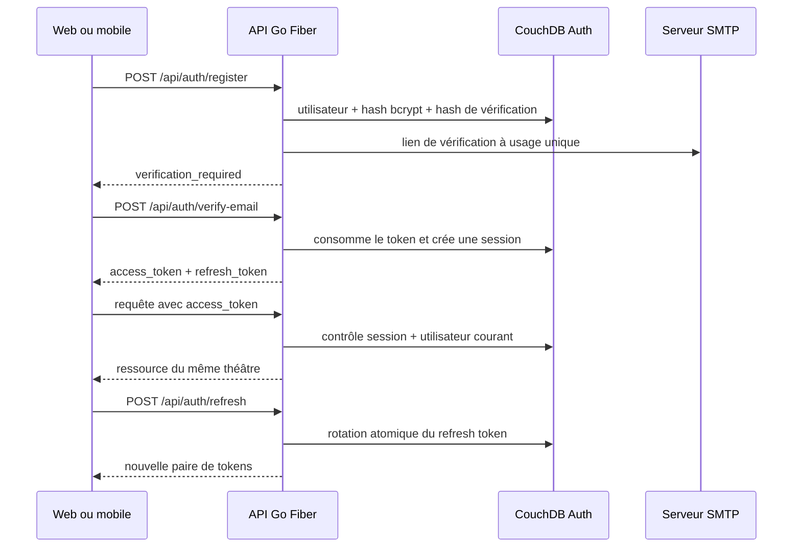

# Sécurité et authentification

Le backend Go Fiber est l'autorité d'identité de StageOps. Les documents d'identité, sessions, appareils et audits d'authentification sont stockés dans `COUCHDB_AUTH_DB`. Les données opérationnelles restent dans `COUCHDB_DB` et sont isolées par `theatre_id`.

## Flux principal

## Propriétés de sécurité

- Les mots de passe sont hachés avec bcrypt, coût 12, et ne sont jamais journalisés.
- La politique impose 12 à 72 octets, avec minuscule, majuscule, chiffre et caractère spécial.
- L'identifiant CouchDB d'un utilisateur est un HMAC de l'email avec `USER_ID_SECRET`; l'email n'apparaît pas dans `_id`.
- Les access tokens HS256 durent 15 minutes et portent `iss`, `aud`, `sub`, `jti`, `token_type` et `theatre_id`.
- Les refresh tokens durent 30 jours, sont aléatoires, rotatifs et stockés uniquement sous forme de hash SHA-256.
- La réutilisation du refresh token précédent révoque sa famille de session.
- `logout` révoque une session; `logout-all` révoque toutes les sessions de l'utilisateur.
- Le middleware relit la session et l'utilisateur dans CouchDB : une session révoquée ou un rôle modifié prend effet immédiatement.
- Les tokens de vérification email sont à usage unique, hachés et valables 24 heures.
- Les réponses de renvoi d'email ne révèlent pas l'existence d'un compte.
- Les requêtes JSON d'authentification sont limitées à 16 Kio et refusent les champs inconnus.
- Les échanges publics sont terminés par Caddy avec TLS 1.3 exclusivement.

## Autorisation hors-ligne

Après une connexion en ligne réussie, un client authentifié peut enregistrer un appareil via `POST /api/auth/offline-grants`. L'API renvoie une autorisation signée Ed25519, valable au maximum sept jours, contenant l'utilisateur, le théâtre, le rôle, les modules et l'appareil.

La clé publique est disponible sur `GET /.well-known/jwks.json`. Une application peut donc vérifier localement l'autorisation sans embarquer de secret serveur. Un grant offline n'est jamais accepté comme access token par l'API en ligne.

Une révocation d'appareil empêche son usage en ligne et la délivrance de nouvelles autorisations. Un appareil réellement déconnecté ne peut pas recevoir cette révocation : son grant déjà téléchargé reste valable jusqu'à son expiration. Les clients doivent supprimer les données locales à l'expiration ou lors d'une révocation reçue après reconnexion.

L'autorisation offline permet l'ouverture contrôlée de la base PouchDB locale. Elle ne donne pas un accès direct au compte administrateur CouchDB. La réplication distante doit passer par un mécanisme de synchronisation dédié et filtré par théâtre; les bases d'authentification et d'audit ne doivent jamais être répliquées vers les clients.

## Routes

| Méthode | Route | Accès | Résultat |
|---|---|---|---|
| `POST` | `/api/auth/register` | public si activé | compte en attente de vérification |
| `POST` | `/api/auth/verify-email` | public, limité | première paire de tokens |
| `POST` | `/api/auth/resend-verification` | public, limité | réponse générique |
| `POST` | `/api/auth/login` | public, limité | paire access/refresh |
| `POST` | `/api/auth/refresh` | refresh token | paire renouvelée |
| `POST` | `/api/auth/logout` | refresh token | révocation d'une session |
| `POST` | `/api/auth/logout-all` | access token | révocation de toutes les sessions |
| `GET` | `/api/auth/me` | access token | utilisateur courant |
| `GET` | `/api/auth/devices` | access token | appareils du compte |
| `POST` | `/api/auth/offline-grants` | access token | grant offline et appareil |
| `DELETE` | `/api/auth/devices/:id` | access token | révocation d'un appareil |
| `GET` | `/.well-known/jwks.json` | public | clé Ed25519 publique |

## Persistance côté client

Le client doit conserver le refresh token dans le stockage sécurisé de la plateforme, jamais dans une base PouchDB répliquée ni dans `localStorage` sur le web. Au redémarrage, il appelle `/api/auth/refresh`. L'access token reste en mémoire. Le grant offline et la clé publique JWKS peuvent être conservés avec les métadonnées de la base locale.

## Audit

Les créations de compte, succès et échecs de connexion, validations d'email, rotations et révocations de session, créations de grants et révocations d'appareil produisent des entrées d'audit rattachées au théâtre. Aucun mot de passe, email brut, access token, refresh token ou token de vérification n'est écrit dans ces événements.
